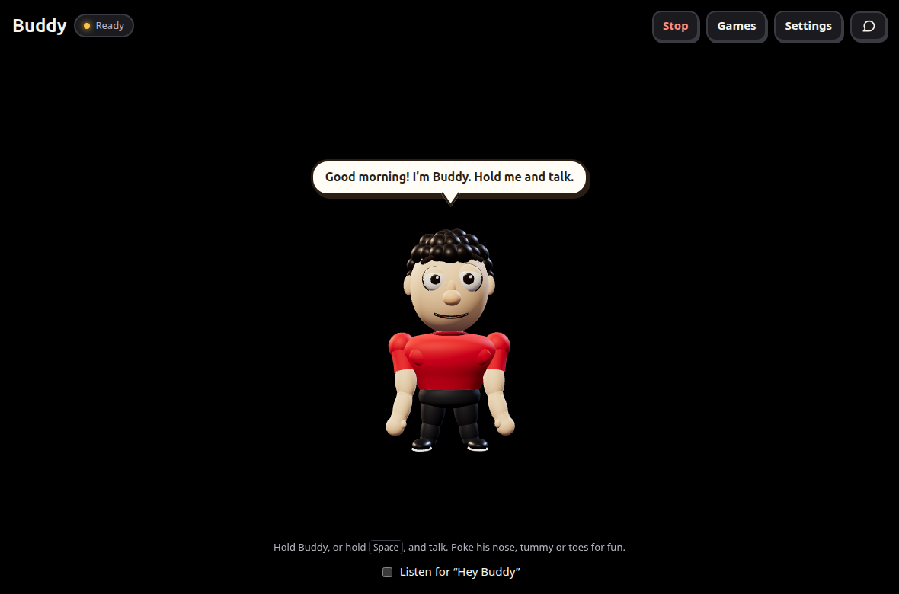

# Buddy

**A voice assistant that controls your whole Linux laptop, using AI that runs on the laptop itself.**

Talk to it at your desk, or message it on WhatsApp from anywhere. It opens apps, plays music, clicks
buttons, reads documents, answers questions, and streams your live screen to your phone. It understands
English and Telugu. No AI service is involved, and there's no subscription.

## What it can do

- **Control the laptop by voice or message:** apps, websites, windows, typing, shortcuts, volume, Wi-Fi, Bluetooth, brightness.
- **Use any app:** clicks what it finds on screen by name, and the local AI works through anything else step by step.
- **Chat over WhatsApp:** ask questions, review text, get code. Your phone becomes the interface to the model.
- **Read what you send:** photos, PDFs, Word files, sheets and slides, with your caption as the question.
- **Download and convert:** "download this link as a PDF and send it to me". Audio, video, pictures, documents and zip.
- **Show your screen live on your phone**, view-only or with control, through a browser with no app to install.
- **Reminders and timers**, delivered on WhatsApp or aloud.
- **The laptop's location**, sent to your WhatsApp as a Maps link.
- **English and Telugu**, spoken or typed, including Telugu in English letters ("chrome open cheyyi").
- **A character with moods:** Buddy listens, thinks, talks, cheers, gets confused and falls asleep. Its eyes follow your pointer, and it reacts when poked.

## Will it run on my laptop?

It needs **Ubuntu with GNOME on an Xorg session**, on a 64-bit Intel or AMD processor, with at least 8 GB of
memory and 5 GB of free disk. Buddy is built and tested on Ubuntu 24.04. Windows, macOS and Wayland sessions
won't work, because Wayland deliberately stops apps from controlling each other.

The installer looks at your hardware and picks the setup that suits it:

| Setup | Chosen when you have | What you get |
| --- | --- | --- |
| **full** | NVIDIA with 8 GB+ of video memory, 16 GB+ of memory, 15 GB+ of free disk | Gemma 4 (`e4b`, about 6.6 GB) on the graphics card, with everything above |
| **light** | 16 GB+ of memory and 12 GB+ of free disk, with a smaller card or none | A smaller Gemma 4 (`e2b`, about 4.6 GB) with the same features, on the processor if there's no suitable card |
| **basic** | Anything less, down to 8 GB of memory | Built-in commands, by voice and WhatsApp. No AI chat, file reading or Telugu |

On a 16-thread Ryzen 9 with the graphics card unused, the light model wrote about 37 tokens a second and read a test picture
correctly. A slower processor will be slower. Both models got all 12 requests right in a small Telugu and English test.
Graphics cards other than NVIDIA aren't detected, so those laptops get the light setup.

## Install

    git clone https://github.com/tejavadlamudi03/buddy.git ~/buddy
    cd ~/buddy
    scripts/install.sh --check     # shows what it would choose, and changes nothing
    scripts/install.sh             # installs it

It lists the system packages it wants and asks before installing them: a C compiler and headers, `ffmpeg`, `poppler-utils`,
LibreOffice, Chrome and the accessibility libraries. Everything else stays in this folder and
`~/.local/share/buddy`. If a step fails, fix it and run the script again, and it carries on.

- Choose a setup yourself: `scripts/install.sh --profile=light`, or `--no-ai` for the basic one.
- See what's working at any time: `.venv/bin/buddy check`.
- Switch setups later: `scripts/install.sh --profile=light`.

### If there's no Xorg

- **On Ubuntu 24.04:** log out, click your name, and choose "Ubuntu on Xorg" under the gear icon at the bottom right.
  If there's no gear icon, check `WaylandEnable` in `/etc/gdm3/custom.conf`. If the option is still missing, run
  `sudo apt install xorg` and restart.
- **On a newer Ubuntu with no Xorg session:** install Ubuntu 24.04. Without Xorg, screenshots, clicking, typing,
  window control and the live screen can't work.

## Using Buddy

Open **Buddy** from the app menu, or run `.venv/bin/buddy`. It starts by itself at every login and restarts after a
crash, though it can't run until someone has logged in after a reboot.

**Hold Buddy**, or hold the **space bar**, and talk. Or tick **Listen for "Hey Buddy"**, then say "Hey Buddy" and wait for
"Yes?", or say it all at once: "Hey Buddy, what time is it". Right after a command, the next known command works without
saying "Buddy". **Esc** cancels what's running.

"Hey Buddy" works while Buddy's window is open, even minimised, but not once it's closed. It keeps the microphone on and
transcribes speech on your laptop, and nothing leaves it. It ignores you while the screen is locked, so nobody can give
commands at a lock screen.

| Say | What happens |
| --- | --- |
| "Go to YouTube" / "Open VS Code" | Opens the site, or focuses the app if it's open |
| "Play tum hi ho", "Next", "Pause", "Volume 30" | Music and media |
| "Change the song to believer", "What song is this" | Replaces the song in the same tab, or names it |
| "Open VS Code and send me a screenshot on WhatsApp" | Chains the steps |
| "Type hello world" / "Press control shift t" | Types or presses keys in the current window |
| "New tab", "Go back", "Copy", "Paste", "Save", "Scroll down" | Common shortcuts |
| "Minimize", "Maximize", "Close Chrome", "Snap left", "Next workspace" | Windows |
| "Click Save", "Double click report", "Read the screen" | Finds that text in the front window and clicks or reads it |
| "Turn off Bluetooth", "Dark mode on", "Brightness 40", "Do not disturb" | System settings |
| "Find report", "List my downloads", "Send me report.pdf" | Your files |
| "Download https://example.com/a.docx as pdf and send it to me" | Saves it in Downloads, converts it, and sends it if you asked |
| "Convert report.docx to pdf", "Send me the latest download as mp3" | Converts a file you already have. The original stays |
| "Remind me in 10 minutes to call home", "Set a timer for 5 minutes" | Tells you when it's time |
| "What are my reminders", "Cancel the reminder about rent" | Lists or removes them |
| "Stay awake for 2 hours", "Allow sleep" | Stops the laptop sleeping, even with the lid closed |
| "Use the funny voice", "Talk like a robot", "Use the giant voice", "Go back to the normal voice" | Changes how Buddy sounds, in English and Telugu. It's also under Settings |
| "Share my location", "Where is my laptop" | Sends the laptop's location to your WhatsApp as a Maps link, and says how accurate it is |
| "How is my laptop" | Battery, memory, disk, Wi-Fi, windows and what's playing |
| "Share my screen", "Share my screen with control", "Stop sharing" | Live screen on your phone |
| "Run df -h" | Reads the command back, then runs it after "yes" and returns the output |
| "Lock", "Shut down", "Restart" | Shutdown, restart, suspend and logout ask you to say "yes" |
| "Stop" | Cancels whatever is running |
| Anything else | The local AI answers, or looks at the screen and works through it |

## WhatsApp

Buddy needs **its own WhatsApp account** to stay linked on the laptop, and takes commands from **one number** you choose.
If two laptops share an account, both read your message and both act on it.

1. Enter the number you'll message from, with country code, under Settings.
2. Run `.venv/bin/buddy whatsapp-login` and scan the QR code with the account that stays on the laptop. The WhatsApp
   Business app works too: Settings > Linked devices.
3. Tick "Take commands from this number" under Settings.

Then send anything you'd say aloud, and replies come back as text. Voice notes work in English or Telugu. Photos and
documents are read by the local AI, using your caption as the question, and you can ask more about them for 30 minutes. A copy
is saved in Downloads. It reads about 12000 characters of a document, or the first 3 pages of a scan, and says when it stopped.
Files you ask for are sent up to 50 MB, and bigger ones stay on the laptop.

- Commands are read only from the chat with your number, and only messages under 3 minutes old. Messages sent while Buddy
  is stopped or restarting are never answered.

### Letting other people chat

Set a password under Settings > Other WhatsApp chats. It's off until you do. Anyone who then messages the linked number is
asked for it once, and after 3 wrong tries they're ignored for an hour. With the password, they can chat with the local AI for
7 days, by text only, with up to 30 messages an hour. Changing the password signs everyone out.

- **They can only chat.** Their words go only to the model, in a separate conversation, so they can't control the laptop, read
  your files or see your own chats. Only your number can give commands.
- **Groups are never answered,** and unread messages older than 3 minutes are left unread.
- **One answer at a time.** Up to 10 people can wait in line, and each is told their place. Your own requests go first.
- **Everyone who messages that number gets the password question,** including people you know. Automatic replies to many
  people could also break WhatsApp's rules and get the account restricted, so use a number you can afford to lose.
- The laptop must be awake and signed in to your desktop. Say "Stay awake" before you leave, and keep it plugged in and out
  of a bag. A laptop that's already asleep can't be woken by message.
- "Unlock" works only from your WhatsApp number, after a "yes", because anyone in the room could say it at the lock screen.
- It uses WhatsApp Web in a hidden Chrome window, not Meta's Business API, so it can break when WhatsApp changes its page.

## Reminders

They survive a restart. The laptop must be awake at that time, so use "Stay awake" for anything important: a reminder due
while it slept arrives after it wakes, and says when it was due. Buddy repeats the time back, so you can check it understood.
A time with no am or pm means the next one coming up today, or a waking hour tomorrow.

## English and Telugu

No training is needed. Known English commands run straight away. Anything else also goes through a Whisper model tuned for
Telugu, and the local AI decides which language was spoken from the two transcripts. Telugu is then translated into the same
commands, so risky actions still ask first, and అవును, వద్దు and ఆపు work as yes, no and stop. With hands-free on, say the wake
word, or Telugu isn't tried at all, which keeps room noise away from it.

A spoken Telugu voice note took about 6 to 7 seconds to understand on the full setup. Replies to commands are in English, and
the AI's own answers follow your language. Telugu was tuned mostly on computer-generated voices, so expect some mishearing
with real speech, and say "stop" in English when it matters.

## Live screen on your phone

Say "Share my screen", or use Settings, then open the link or scan the code. Nothing to install.

- View-only unless you tick "Let the phone control this laptop" or say "with control". With control: tap to click, press and hold to right-click, type, or talk to Buddy.
- It expires after 60 minutes, and Buddy announces aloud when a device connects. Each share gets a new link.
- It's a fast series of pictures rather than video, so quick movement looks choppy, and laptop audio isn't sent.

## How it works

    mic or WhatsApp -> local Whisper -> rules (parser.py) -> actions.py -> the desktop
                                            \-> not recognised: the local AI reads it (language.py)
                                                   a command: rules again, then AI + OCR + screenshot (agent.py)
                                                   a question or a file: a reply, with no actions

Whisper hears, Piper speaks, Linux accessibility and RapidOCR read apps, and an open source model in Ollama thinks. Clicks only
ever target the front window. Known commands need no AI at all, so they're instant.

| File | What it does |
| --- | --- |
| `engine.py` | Wake word, stop, confirmation, and what runs next |
| `parser.py`, `actions.py` | Everyday words into steps, and the fixed list of what can be done |
| `agent.py`, `ai.py`, `language.py` | The local AI: working through the screen, chat, translation |
| `listen.py`, `stt.py`, `tts.py` | Hearing and speaking |
| `whatsapp.py`, `attachments.py` | The WhatsApp bridge, and reading files sent to it |
| `fetch.py`, `reminders.py`, `awake.py`, `files.py` | Downloads and conversions, reminders, staying awake, your files |
| `share.py`, `static/` | The live screen, and Buddy's face |

## Privacy and safety

- **On your laptop:** voice, screen contents and AI processing. The exceptions are websites you ask for, WhatsApp, downloads, and screen sharing when you turn it on.
- **Commands only from you:** the server listens on `127.0.0.1` and each call needs the token in `~/.config/buddy/config.json`. Treat Buddy's link like a password.
- **Pasted text and files are only discussed.** Anything with several lines, over 300 characters, or sent as a file goes to a conversation with no actions, so text inside it can't run as a command.
- **The AI has limits.** It picks only from a fixed list of actions (`AGENT_ACTIONS`), and it can't power off the laptop, start screen sharing, download files or run commands of its own. It's told to ask before sending, buying or deleting, but that part is an instruction to the model and not a hard limit, so watch it on sensitive pages. It can type into a terminal only if your request mentions a terminal, command, install or similar, and the VS Code terminal isn't covered by that check.
- **Private files stay private.** Buddy won't find, read, send or convert anything in `.ssh`, `.gnupg`, `.aws`, browser and mail profiles or its own data, or files like `.env` and `*.pem`. Add your own folders under `private_folders` in the config, and restart Buddy. A "run" command you confirm yourself isn't limited by this.
- **Screen sharing goes through a temporary Cloudflare tunnel.** The link is encrypted, but Cloudflare's servers handle the traffic, and anyone with the link can see your screen until it ends. The tunnel reaches only a small separate server, never Buddy's main token or settings.
- **Converting opens the file** in `ffmpeg` or LibreOffice, so only use links you trust. A downloaded file is never run.
- **Your location is looked up only when you ask.** Buddy sends the addresses of nearby Wi-Fi networks and your internet address to [beaconDB](https://beacondb.net/), and the link goes to your own WhatsApp chat. The local AI can't request it. This doesn't use Ubuntu's Location Services, so turning those off doesn't stop it.

## Settings

They're in `~/.config/buddy/config.json`. Restart Buddy after changing them with `systemctl --user restart buddy`.

| Setting | What it changes |
| --- | --- |
| `ai_model`, `ai_context` | Which model, and how much it can hold at once. Lower `ai_context` if memory runs short |
| `agent_enabled` | `false` turns the local AI off |
| `whisper_model`, `voice_note_model` | Speech models for the mic and for voice notes. Smaller ones are faster |
| `private_folders` | Extra folders Buddy must never touch |
| `agent_max_steps`, `share_minutes`, `port` | The AI's step limit, how long a share lasts, the local port |

## What it can't do yet

- Run on anything but Ubuntu with Xorg, or speed up on graphics cards other than NVIDIA.
- Remember you over time. It keeps the last 6 exchanges until it restarts, and the model never learns from you.
- Look things up online when chatting, so recent facts may be out of date.
- Send files over 50 MB, download from YouTube and similar sites, or work while the laptop is asleep.
- Send a WhatsApp location pin or live location, or know where your phone is. It sends a link to where the laptop is at that moment, and where beaconDB doesn't know the nearby Wi-Fi networks, that's only a rough area, up to about 25 km off.
- Understand languages other than English and Telugu.

## Tests

    env -u PYTHONPATH uv run --group dev pytest   # a sourced ROS environment breaks pytest otherwise

The tests fake WhatsApp and the desktop, so changes to those also need trying for real.
