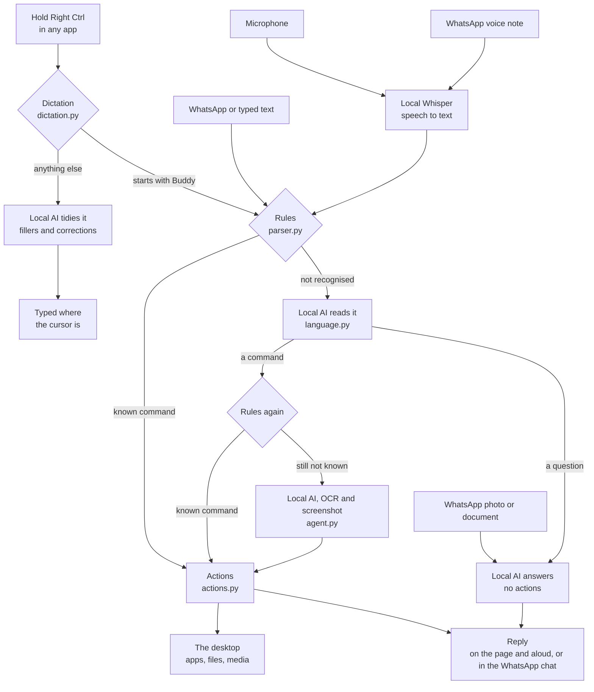

# Buddy

**A voice assistant that controls your whole laptop, on Ubuntu or Windows, using AI that runs on the laptop itself.**

Talk to it at your desk, or message it on WhatsApp from anywhere. It opens apps, plays music, clicks
buttons, reads documents, answers questions, plays games, and streams your live screen to your phone. It
understands English, German, Hindi and Telugu. No AI service is involved, and there's no subscription.

## Features

**Control the laptop**
- Open, switch, arrange and close apps and windows, and open any website.
- Play, skip and find music and videos, and change the volume and brightness.
- Type, press any keys, click what's on screen by name, and read the screen aloud.
- Change Wi-Fi, Bluetooth, dark mode, night light, do not disturb and power modes.
- Find, open, send and convert your files, and download from links.
- Work through anything else step by step: the local AI looks at the screen and acts on it.

**Reach it from anywhere**
- **WhatsApp:** send commands, chat with the AI, send photos and documents to be read, and get files and screenshots back.
- **Live screen on your phone:** view-only or with control, in a browser with no app to install.
- **Unlock from WhatsApp** (Ubuntu only), keep the laptop awake while you're away, and ask where it is.
- **Other people** can chat with the AI on your WhatsApp number if you set a password. They can't control the laptop.

**Talk to it your way**
- **Dictate in any app:** hold Right Ctrl and speak, and your words are typed where the cursor is, with the "um"s and corrections tidied by the local AI. Like Wispr Flow, but nothing leaves the laptop.
- Hold-to-talk, hands-free "Hey Buddy", typing, voice notes or text messages.
- **English, German, Hindi and Telugu**, spoken or typed, including Hindi and Telugu in English letters ("chrome open cheyyi", "gaana band karo").
- Four voices: normal, funny, robot and giant.
- Reminders and timers, delivered on WhatsApp or aloud.

**Have fun with it**
- **A 3D cartoon character** with a gym build, who listens, thinks, talks, cheers, flexes and falls asleep. See [Playing with Buddy](#playing-with-buddy).
- **Tracking:** his eyes and head follow your pointer around the window.
- **Poking:** his hair, nose, tummy and toes each react with their own sound.
- **Eight games** with the local AI, seven of them playable as WhatsApp text chats and the other with a photo. See [Games](#games).

**Keep it yours**
- All the AI runs on your laptop, with no AI service or subscription, and you can [choose or download another model](#choosing-the-ai-model) to suit your hardware.
- Risky actions ask first, private files stay out of reach, and only your number can give commands. See [Privacy and safety](#privacy-and-safety).
- Runs on **Ubuntu**, and now on **Windows 10 and 11** too, which is new and not yet tried on a real Windows laptop. See [Buddy on Windows](#buddy-on-windows).

## How Buddy compares

Buddy isn't an AI model. It's an assistant built on open models that run on your laptop: Gemma 4 thinks, Whisper hears and
Piper speaks. So the fair comparison is with other assistants.

| | Buddy | [OpenClaw](https://www.digitalocean.com/resources/articles/what-is-moltbot) | Cloud assistants (ChatGPT agent, Claude, Copilot, Siri) | [Wispr Flow](https://wisprflow.ai/data-controls) |
| --- | --- | --- | --- | --- |
| Where the AI runs | Always on your laptop | Usually cloud models. Local ones are possible through Ollama, but [hard in practice](https://www.mindstudio.ai/blog/what-is-openclaw-ai-agent) | Their servers | Its cloud, for every word |
| Cost | Free, with no API keys | Free software, but you pay for the model's API | Subscriptions or usage fees | Subscription |
| How you use it | Voice first, dictation in any app, WhatsApp, typing | Chat apps such as WhatsApp, Telegram and Slack | Their apps, or the operating system | Dictation only |
| What it controls | The whole desktop: it sees the screen, clicks buttons by name and types in any app | Files, scripts, the browser and online accounts | Varies, often a browser or what the system allows | Nothing, it only types |
| Your screen on your phone | Live, view-only or with control | No | No | No |
| Everyday commands | Instant, with no AI, from a fixed list of commands | Through the model | Through the model | No |

**Where Buddy is behind:** a small local model is much weaker than the cloud models the others use, so long tasks on screen
are less reliable. It remembers only the last few exchanges, can't search the web when chatting, has no add-on skills or
community, and has had no security review. Larger projects are tested by many people: OpenClaw, for example, had a
[serious security flaw](https://www.proarch.com/blog/threats-vulnerabilities/openclaw-rce-vulnerability-cve-2026-25253) found
and fixed because so many people use it. Buddy hasn't had that scrutiny.

**In one line:** a private, voice-first assistant that controls your whole laptop and shows it on your phone, with nothing
leaving the machine and nothing to pay.

## Will it run on my laptop?

It needs **Ubuntu with GNOME on an Xorg session** or **Windows 10 or 11** (see [Buddy on Windows](#buddy-on-windows)), on a
64-bit Intel or AMD processor, with at least 8 GB of memory and 5 GB of free disk. Buddy is built and tested on Ubuntu 24.04.
macOS and Wayland sessions won't work, because Wayland deliberately stops apps from controlling each other.

The installer looks at your hardware and picks the setup that suits it:

| Setup | Chosen when you have | What you get |
| --- | --- | --- |
| **full** | NVIDIA with 8 GB+ of video memory, 16 GB+ of memory, 15 GB+ of free disk | Gemma 4 (`e4b`, about 6.6 GB) on the graphics card, with everything above |
| **light** | 16 GB+ of memory and 12 GB+ of free disk, with a smaller card or none | A smaller Gemma 4 (`e2b`, about 4.6 GB) with the same features, on the processor if there's no suitable card |
| **basic** | Anything less, down to 8 GB of memory | Built-in commands, by voice and WhatsApp, and Hangman. No AI chat, file reading, other games or other languages |

On a 16-thread Ryzen 9 with the graphics card unused, the light model wrote about 37 tokens a second and read a test picture
correctly. A slower processor will be slower. Both models got all 12 requests right in a small Telugu and English test.
Graphics cards other than NVIDIA aren't detected, so those laptops get the light setup.

## Install

    git clone https://github.com/tejavadlamudi03/buddy.git ~/buddy
    cd ~/buddy
    scripts/install.sh --check     # shows what it would choose, and changes nothing
    scripts/install.sh             # installs it

It lists the system packages it wants and asks before installing them: a C compiler and headers, `ffmpeg`, `poppler-utils`,
LibreOffice, Chrome and the accessibility libraries. Everything else stays in this folder and
`~/.local/share/buddy`. If a step fails, fix it and run the script again, and it carries on.

- Choose a setup yourself: `scripts/install.sh --profile=light`, or `--no-ai` for the basic one.
- See what's working at any time: `.venv/bin/buddy check`.
- Switch setups later: `scripts/install.sh --profile=light`.

On Windows, see [Buddy on Windows](#buddy-on-windows).

### If there's no Xorg

- **On Ubuntu 24.04:** log out, click your name, and choose "Ubuntu on Xorg" under the gear icon at the bottom right.
  If there's no gear icon, check `WaylandEnable` in `/etc/gdm3/custom.conf`. If the option is still missing, run
  `sudo apt install xorg` and restart.
- **On a newer Ubuntu with no Xorg session:** install Ubuntu 24.04. Without Xorg, screenshots, clicking, typing,
  window control and the live screen can't work.

## Buddy on Windows

> **New, and not yet tried on a real Windows laptop.** It has only been checked against simulated Windows libraries. A workflow
> in `.github/workflows/windows.yml` tests it on a real Windows machine whenever it's pushed. Expect rough edges.

Install it from a normal PowerShell window, not as administrator. You need [Git](https://git-scm.com/download/win):

    git clone https://github.com/tejavadlamudi03/buddy.git $HOME\buddy
    cd $HOME\buddy
    powershell -ExecutionPolicy Bypass -File scripts\install.ps1 -Check   # shows what it would choose, and changes nothing
    powershell -ExecutionPolicy Bypass -File scripts\install.ps1          # installs it

It picks a setup the same way as on Ubuntu, and asks before using `winget` to install FFmpeg, Poppler and LibreOffice. It uses
Chrome if you have it, and otherwise Edge, for Buddy's page and for WhatsApp. Everything else stays in this folder and
`AppData\Local\Buddy`, and your settings are in `AppData\Roaming\Buddy`. It adds Buddy to the Start menu and starts it when
you log in, with no console window. Its output goes to `AppData\Local\Buddy\buddy.log`. To stop it starting by itself, turn it
off under Task Manager > Startup apps. To see what's working: `.venv\Scripts\buddy check`.

Commands are the same, with these differences:

| Feature | On Windows |
| --- | --- |
| **Unlock from WhatsApp** | **Not possible.** Windows only lets a person signing in unlock it, so Buddy tells you this instead |
| **While locked** | Windows hides the desktop from every app, so Buddy can't see, click, type or share the screen. The phone shows a "locked" notice. AI chat, reminders, files on WhatsApp and "Lock" still work. If you need control from far away, **don't lock it before you leave** |
| **Stay awake** | Stops it sleeping, but can't overrule the lid. Leave the lid open, or set "When I close the lid" to do nothing under Power settings. While your screen is shared, it also keeps the screen on so it doesn't time out and lock |
| **Airplane mode, night light, do not disturb** | Windows has no way for apps to switch these, so Buddy opens the right Settings page for you |
| **Wi-Fi and Bluetooth** | Work, through Windows' own radio controls |
| **Brightness** | Works on a laptop's own screen, not usually on an external monitor |
| **Power modes** | Only those Windows offers: many newer laptops have Balanced only, and the others will fail |
| **Record the screen** | Presses Win+Alt+R, for Xbox Game Bar, which records one app rather than the desktop, and has to be switched on |
| **Running commands** | "Run ..." uses PowerShell. The local AI can only run `whoami`, `hostname`, `tasklist`, `systeminfo`, `driverquery`, `where` and `nvidia-smi` |
| **Location** | Windows 11 may need Location turned on to list Wi-Fi networks. Without that it's a rough guess from your internet connection |
| **Dictation** | Records through `sounddevice` instead of PipeWire. Untested on Windows |
| **Word, Excel, PowerPoint** | Open Microsoft Office if you have it. Say "LibreOffice Writer" for that |

## Using Buddy

Open **Buddy** from the app menu, or run `.venv/bin/buddy`. It starts by itself at every login and restarts after a
crash, though it can't run until someone has logged in after a reboot.

| To do this | Do this |
| --- | --- |
| Talk | Hold Buddy with the mouse, or hold the **space bar**, while you speak |
| Dictate in any app | Hold **Right Ctrl**, speak, and let go. See [Dictation](#dictation-in-any-app) |
| Command Buddy from any app | Hold **Right Ctrl** and say "Buddy, open YouTube". Buddy's window doesn't need to be open |
| Talk hands-free | Tick **Listen for "Hey Buddy"**, then say "Hey Buddy" and wait for "Yes?", or say it all at once: "Hey Buddy, what time is it" |
| Type | Open the chat with the speech-bubble button at the top right |
| Cancel what's running | Press **Esc** or **Stop**, or say "Stop" |
| Play a game | Press **Games** |
| Change settings | Press **Settings** |

Right after a command, the next known command works without saying "Buddy".

"Hey Buddy" works while Buddy's window is open, even minimised, but not once it's closed. It keeps the microphone on and
transcribes speech on your laptop, and nothing leaves it. It ignores you while the screen is locked, so nobody can give
commands at a lock screen.

## Dictation in any app

Like [Wispr Flow](https://wisprflow.ai), but local. Wispr Flow itself sends your voice to its cloud, has no Linux app
and no API, so Buddy does the same job on the laptop instead.

1. Put the cursor where the text should go, in any app: a chat, an email, a document, a code editor.
2. Hold **Right Ctrl** and speak. Let go when you're done.
3. About two seconds later for English, the text is typed there.

The local AI tidies what you said into what you meant, and nothing else:

| You say | It types |
| --- | --- |
| "Um, so the train leaves at six, no wait, at seven tonight" | So the train leaves at 7 tonight. |
| "Hey, uh, I just wanted to let you know that I will be, um, late today, sorry" | Hey, I just wanted to let you know that I will be late today, sorry. |
| "What is the capital of France" | What is the capital of France? It writes your question down, and never answers it |
| "Ich komme morgen um drei Uhr, äh, nein, um vier Uhr" | Ich komme morgen um 4 Uhr. |

- **Starting with "Buddy" makes it a command** instead, in any of its languages: "Buddy, open YouTube" works from any app.
- **English, German, Hindi and Telugu.** English takes about 2 seconds after you let go. The others take 6 to 11 seconds, as
  the language is detected first and then its own model listens. Telugu is only cleared of "um"s and given a full stop,
  because the local AI changed the meaning of both Telugu sentences it was tested on.
- **A quick tap of Right Ctrl, or a shortcut like Right Ctrl+C, does nothing.** Only holding it on its own for at least
  0.4 seconds dictates.
- **Teach it names and words** it gets wrong: "Add Bhanuteja to my dictionary". Both the speech model and the tidying
  then spell them that way, for commands too. "What's in my dictionary", "Remove Bhanuteja from my dictionary".
- **Turn it off** with the tick box on Buddy's page, or say "Turn off dictation". Another key: set `dictation_key` in the settings.
- Without the local AI, it still types what you said, with the "um"s taken out.
- The key is watched in every app, but only that key. Other keys are only noticed as "another key was pressed", to tell a
  shortcut from dictation, and are never kept. The recording is deleted as soon as it's been heard.

Tested with real key presses on a separate virtual screen, and with generated voices in all four languages. Your own
voice and microphone haven't been tested yet.

## All the commands

Say these aloud, type them, or send them on WhatsApp. The wording is flexible: "please", "can you" and "Buddy" at the start are
ignored, and most have other natural ways to say them. Join steps with "and" or "then": "Open VS Code and send me a screenshot on WhatsApp".
**Anything not listed here goes to the local AI**, which answers it or works through it on the screen.

Commands marked **asks first** wait for a "yes", which must come within 30 seconds and from the same place you asked. Anything
else cancels them.

### Talking to Buddy

| Say | What happens |
| --- | --- |
| "Hey Buddy", "Buddy" | Answers "Yes?" and listens to the next thing you say |
| "Stop", "Cancel", "Abort" | Cancels whatever is running, and ends a game |
| "Yes", "Yeah", "Confirm", "Do it", "Go ahead" | Confirms what Buddy just asked |
| "No", "Nope", "Never mind", "Not now" | Cancels what Buddy just asked |
| "Hello", "Are you there", "Thank you" | A friendly reply |
| "What time is it", "What's the date", "What day is it" | Tells you |

### Apps and windows

| Say | What happens |
| --- | --- |
| "Open VS Code", "Launch calculator", "Start Files", "Run Chrome" | Opens the app, or focuses it if it's already open |
| "Switch to Chrome", "Focus on terminal" | Brings that window to the front |
| "Close Chrome", "Quit calculator" | Closes that app |
| "Close", "Close this window" | Closes the front window |
| "Minimize", "Maximize" | Changes the front window |
| "Snap left", "Snap the window to the right" | Fills half the screen |
| "Switch windows", "Next window", "Alt tab" | Goes to the next window |
| "Show all windows", "Overview" | Shows the overview |
| "Next workspace", "Previous workspace" | Changes workspace |
| "New window", "Full screen" | In the front app |

Any installed app works by its name. These other names work too: "code" and "vscode" for VS Code, "browser" for Chrome,
"word", "excel" and "powerpoint" for LibreOffice, "notepad" for the text editor, "file manager" and "explorer" for Files,
"task manager" for System Monitor, "email" for Thunderbird, "music" for Rhythmbox, "photos" for Shotwell, and "app store".

### Websites and search

| Say | What happens |
| --- | --- |
| "Go to YouTube", "Open Gmail", "Visit github" | Opens the site |
| "Go to example dot com" | Opens any address you spell out |
| "Search for red shoes", "Look up red shoes", "Google red shoes" | Searches Google, or YouTube if you're already on it |
| "Search for lofi on YouTube", "Find lofi on Google" | Searches that site |

Sites known by name: YouTube, Google, Gmail, mail, Google Drive, Google Maps, calendar, Claude, ChatGPT, GitHub, GitLab, LinkedIn,
Instagram, Facebook, Twitter, Reddit, Netflix, Amazon, Wikipedia, WhatsApp and Spotify.

### Music and video

| Say | What happens |
| --- | --- |
| "Play tum hi ho", "Play a song pesamale", "Play the video lofi beats" | Plays the first result on YouTube |
| "Change the song to believer", "Put on believer", "Listen to believer" | Replaces what's playing, in the same tab |
| "Play it", "Play the first one" | Plays what you just searched for |
| "Pause", "Stop the music" | Pauses |
| "Resume", "Play", "Continue" | Carries on |
| "Next", "Skip", "Change the song", "Play another song", "I don't like this song" | Next track |
| "Previous", "Play the last song" | Previous track |
| "What song is this", "What am I listening to" | Names it |

### Volume and brightness

| Say | What happens |
| --- | --- |
| "Volume 30", "Set the volume to 80", "Max volume" | Sets the volume |
| "Volume up", "Turn it up", "Louder" | Raises it |
| "Volume down", "Turn it down", "Quieter", "Softer" | Lowers it |
| "Mute", "Unmute" | Switches the sound off or on |
| "Brightness 40", "Set the brightness to 70" | Sets the brightness |
| "Brighter", "Brightness up", "Dimmer", "Dim the screen" | Raises or lowers it |
| "80 percent" | Sets whichever of the two you changed last |

### Typing, keys and the mouse

| Say | What happens |
| --- | --- |
| "Type hello world", "Write down hello world" | Types it in the front window |
| "Press control shift t", "Press enter", "Press page down" | Presses those keys |
| "Copy", "Paste", "Cut", "Undo", "Redo", "Select all", "Save" | The usual shortcuts |
| "New tab", "Close tab", "Reopen tab", "Next tab", "Previous tab" | Tabs |
| "Go back", "Go forward", "Refresh" | Browser pages |
| "Find", "Print", "Zoom in", "Zoom out", "Reset zoom" | In the front app. "Find" on its own opens its search box |
| "Scroll down", "Scroll up", "Scroll down a lot", "Scroll up a lot" | Scrolls the front window |
| "Click", "Double click", "Right click" | Clicks where the pointer is |
| "Click Save", "Double click report", "Right click Downloads", "Select the Sound tab" | Finds that text in the front window and clicks it |
| "Read the screen", "What's on my screen", "What does it say" | Reads the front window aloud |

### Laptop settings

| Say | What happens |
| --- | --- |
| "Turn on Wi-Fi", "Turn off Wi-Fi" | Wi-Fi. Turning it off **asks first**, as it can cut you off from far away |
| "Turn on airplane mode", "Turn off airplane mode" | Airplane mode. Turning it on **asks first** |
| "Turn on Bluetooth", "Turn off the microphone" | Bluetooth and the microphone |
| "Turn on dark mode", "Turn on light mode", "Turn on night light" | How the screen looks |
| "Turn on do not disturb", "Turn off notifications" | Notifications |
| "Power saver", "Balanced", "Performance mode" | Power modes |
| "Open sound settings", "Go to display settings" | Opens that page of Settings |
| "Battery", "How much battery is left" | Tells you |
| "How is my laptop", "Send me a system report" | Battery, memory, disk, Wi-Fi, windows and what's playing |
| "Record the screen", "Stop recording" | GNOME's screen recorder |
| "Empty the trash" | **Asks first** |

### Power, lock and staying awake

| Say | What happens |
| --- | --- |
| "Lock", "Lock the screen" | Locks straight away |
| "Is the laptop locked" | Tells you |
| "Unlock" | **Only from your WhatsApp number**, and **asks first** |
| "Shut down", "Restart", "Suspend", "Log out" | **Asks first** |
| "Stay awake", "Stay awake for 2 hours", "Don't sleep" | Stops the laptop sleeping, even with the lid closed |
| "Allow sleep", "You can sleep" | Lets it sleep again |

### Files

| Say | What happens |
| --- | --- |
| "Find report", "Find the file called budget" | Lists matching files |
| "List my downloads", "What's in documents" | Lists a folder: downloads, documents, desktop, pictures, music, videos or home |
| "Open downloads", "Open the pictures folder" | Opens it in Files |
| "Open the file report.pdf" | Opens it in its usual app |
| "Send me report.pdf", "Send me latest download" | Sends it on WhatsApp, up to 50 MB |
| "Download https://example.com/a.docx", "Download https://example.com/a.docx as pdf and send it to me" | Saves it in Downloads, converts it, and sends it if you asked |
| "Convert report.docx to pdf", "Send me report.docx as pdf" | Converts a file you already have. The original stays |

### Screenshots and your screen on the phone

| Say | What happens |
| --- | --- |
| "Take a screenshot" | Saves it in Pictures/Buddy, and from WhatsApp sends it back too |
| "Send me a screenshot", "Send it on WhatsApp" | Sends a new one, or the last one, on WhatsApp |
| "Share my screen" | Live screen on your phone, view-only |
| "Share my screen with control" | The same, and the phone can control the laptop |
| "Stop sharing" | Ends it |

On WhatsApp, just "screenshot" or "screen" works too.

### Reminders and timers

| Say | What happens |
| --- | --- |
| "Remind me in 10 minutes to call home", "Remind me at 5 pm to leave", "Remind me tomorrow at 9 to pay rent" | Sets a reminder, and repeats the time back |
| "Set a timer for 5 minutes", "5 minute timer" | Starts a timer |
| "What are my reminders" | Lists them |
| "Cancel the reminder about rent", "Cancel my reminders" | Removes one, or all of them |

### Voice, location and running commands

| Say | What happens |
| --- | --- |
| "Use the funny voice", "Talk like a robot", "Use the giant voice", "Go back to the normal voice" | Changes how Buddy sounds. It's also under Settings |
| "Share my location", "Where is my laptop" | Sends the laptop's location to your WhatsApp as a Maps link, and says how accurate it is |
| "Run df -h" | Reads the command back, **asks first**, then returns the output |
| "Add Bhanuteja to my dictionary", "Remove ROS from my dictionary", "What's in my dictionary" | Words for dictation and the speech model to spell exactly like that |
| "Turn off dictation", "Turn on dictation" | Whether holding Right Ctrl dictates. It's also a tick box on Buddy's page |

### Questions and writing

Anything that isn't a command goes to the local AI, with no actions, so it can't change the laptop: "What is the capital of Bavaria",
"Write a poem about rain", "Review this text". It remembers the last 6 exchanges. Anything long or with several lines is always
treated as text to discuss, so nothing inside it can run as a command.

### Fun and games

| Say | What happens |
| --- | --- |
| "Let's play a game", "Are there any text games", "I'm bored" | Lists the games |
| "Play riddles", "Play 20 questions", "Play hangman" | Starts that one. See [Games](#games) |
| "One more", "Play again", "Rematch" | Plays the last game again, within 5 minutes |
| "Stop the game", "Quit" | Ends the game |
| "Do a dance", "Make a funny face", "Sneeze", "Do something funny", "Do a trick" | Buddy clowns around |

### From a terminal

| Run | What it does |
| --- | --- |
| `.venv/bin/buddy` | Starts Buddy, or brings its window to the front |
| `.venv/bin/buddy --url` | Prints your private link. Treat it like a password |
| `.venv/bin/buddy --no-open` | Starts it without opening a window |
| `.venv/bin/buddy check` | Says what's working on this laptop, and changes nothing |
| `.venv/bin/buddy whatsapp-login` | Links the WhatsApp account |
| `.venv/bin/buddy install-launcher` | Adds Buddy to the app menu |
| `.venv/bin/buddy install-autostart` | Starts Buddy at every login |
| `.venv/bin/buddy use-profile light` | Switches to the settings for `full`, `light` or `basic` |
| `scripts/install-local-ai.sh`, `scripts/install-telugu.sh`, `scripts/install-languages.sh` | Fetch the AI model, Telugu, and Hindi and German |
| `systemctl --user restart buddy` | Restarts Buddy |
| `journalctl --user -u buddy -f` | Shows its log |

## Playing with Buddy

Buddy is an original 3D cartoon character with curly hair and a gym build, in a fitted red T-shirt and black trousers. His clowning
is inspired by silent comedy. If 3D can't run on your laptop, an older flat drawing of him, in a brown jacket and red tie, takes over
and works the same way.

### Tracking

His eyes and head follow your pointer anywhere in the window, and he watches your pen while you draw in Draw and Guess. Moving the
pointer wakes him if he's asleep. This follows the mouse only: Buddy doesn't use your camera.

### Poking

A quick tap on Buddy pokes him, while holding him for longer means you're talking. Where you poke matters:

| Poke his | What he does |
| --- | --- |
| **Hair** | A boing, "Mind the hair!", and he scratches his head |
| **Nose or face** | A honk, "Ow! My nose!", and he jumps with his eyes popping |
| **Tummy** | A giggle and a wriggle: "Ha ha! That tickles!" |
| **Toes or shoes** | A squeak, "Ooh! My toes!", and he shrugs and grimaces |

**Poke him 5 times quickly** and he gets dizzy, with stars circling his head. **Double-click** him for a wink.

### Moods

| When | He |
| --- | --- |
| Listening | Cups a hand to his ear, with sound waves reaching it |
| Thinking | Rubs his chin and looks up, under a question mark |
| Talking | Moves his mouth with the words, and waves his hands about |
| Good news | Hops about, grinning |
| Something went wrong | Shrugs and grimaces, with a bead of sweat |
| Winning or losing a game | Cheers and dances, or sulks |
| The screen gets brighter | Puts on sunglasses for 15 seconds: "Whoa, too bright!" Turning the brightness down or dark mode on takes them off |
| Left alone | Gets up to something every so often: checks his watch, scratches his head, peeks around, yawns, pulls a face, flexes his muscles, sneezes, or slips on a banana skin |
| Left alone for 3 minutes | Falls asleep and snores, until you move the pointer |

## WhatsApp

Buddy needs **its own WhatsApp account** to stay linked on the laptop, and takes commands from **one number** you choose.
If two laptops share an account, both read your message and both act on it.

1. Enter the number you'll message from, with country code, under Settings.
2. Run `.venv/bin/buddy whatsapp-login` and scan the QR code with the account that stays on the laptop. The WhatsApp
   Business app works too: Settings > Linked devices.
3. Tick "Take commands from this number" under Settings.

Then send anything you'd say aloud, and replies come back as text. Voice notes work in English, German, Hindi or Telugu. If Buddy isn't sure it heard a voice note properly, it tells you what it heard and waits for you to reply yes. Photos and
documents are read by the local AI, using your caption as the question, and you can ask more about them for 30 minutes. A copy
is saved in Downloads. It reads about 12000 characters of a document, or the first 3 pages of a scan, and says when it stopped.
Files you ask for are sent up to 50 MB, and bigger ones stay on the laptop.

- Commands are read only from the chat with your number, and only messages under 3 minutes old. Messages sent while Buddy
  is stopped or restarting are never answered.

### Letting other people chat

Set a password under Settings > Other WhatsApp chats. It's off until you do. Anyone who then messages the linked number is
asked for it once, and after 3 wrong tries they're ignored for an hour. With the password, they can chat with the local AI for
7 days, by text only, with up to 30 messages an hour. Changing the password signs everyone out.

- **They can only chat.** Their words go only to the model, in a separate conversation, so they can't control the laptop, read
  your files or see your own chats. Only your number can give commands.
- **Groups are never answered,** and unread messages older than 3 minutes are left unread.
- **One answer at a time.** Up to 10 people can wait in line, and each is told their place. Your own requests go first.
- **Everyone who messages that number gets the password question,** including people you know. Automatic replies to many
  people could also break WhatsApp's rules and get the account restricted, so use a number you can afford to lose.
- The laptop must be awake and signed in to your desktop. Say "Stay awake" before you leave, and keep it plugged in and out
  of a bag. A laptop that's already asleep can't be woken by message.
- "Unlock" works only from your WhatsApp number, after a "yes", because anyone in the room could say it at the lock screen.
- It uses WhatsApp Web in a hidden Chrome window, not Meta's Business API, so it can break when WhatsApp changes its page.

## Reminders

They survive a restart. The laptop must be awake at that time, so use "Stay awake" for anything important: a reminder due
while it slept arrives after it wakes, and says when it was due. Buddy repeats the time back, so you can check it understood.
A time with no am or pm means the next one coming up today, or a waking hour tomorrow.

## Games

Press **Games** in Buddy's window, or just ask, there or on WhatsApp: "let's play a game", or the name of one. All of them run
on the laptop, and each has a Quit button in Buddy's window.

| Game | How it goes | What to say | Without the local AI |
| --- | --- | --- | --- |
| **20 Questions** | You think of something, and Buddy has 20 questions to work it out | "Yes", "No", "Not sure", "You got it" | No |
| **Guess My Secret** | Buddy thinks of something, and you have 20 questions | Any yes or no question, "Is it a dog?", "Hint", "Give up" | No |
| **Riddles** | Five new riddles, with two tries at each | Your answer, "Hint", "Skip", "Give up" | No |
| **Story Time** | A silly story, a line each for five turns | Your next line, "The end" | No |
| **Adventure** | A text adventure of eight turns | "1", "2", "3", or whatever you want to do | No |
| **Hangman** | Guess the word, with six lives. English words only | "A", "The letter A", or the whole word | **Yes** |
| **Word Chain** | Each word starts with the last letter of the one before, with three lives and no repeats. English words only | One word | No |
| **Draw and Guess** | You draw, and Buddy gets three guesses. Needs a model that can see pictures | Draw on the pad and press **Guess it, Buddy!**, or on WhatsApp send a photo of a drawing. Then "Yes" or "No" | No |

**On WhatsApp** they're ordinary text chats, and the replies come back in the chat. Send **quit** to stop. Voice notes work too,
though a typed answer can't be misheard.

**While you play, everything you say belongs to the game**, so a story about opening a door can't open anything, and a "yes" can't
confirm a shutdown. To give a command without leaving the game, start with Buddy's name: "Buddy, next song". Say **stop** or
**quit** to end it, **one more** to play again. A game left alone for 15 minutes ends by itself. Games are only for your own
number, not for other people using the guest chat.

The rules and the score are in the code, and the model only supplies the words, so it can't give away Guess My Secret by
accident or change the score. It can still answer a question wrongly or write a weak riddle. Expect to beat it at 20 Questions most
of the time: it named the right thing in only 1 of 10 test games.

## English, German, Hindi and Telugu

No training is needed. Known English commands run straight away. Anything else also goes through the other languages' Whisper
models, and the local AI decides which was spoken from the transcripts. What was said is then translated into the same commands,
so risky actions still ask first. These work as yes, no and stop:

| | Yes | No | Stop |
| --- | --- | --- | --- |
| **German** | ja, genau | nein | stopp, halt, aufhören |
| **Hindi** | हाँ, जी, ठीक है, haan | नहीं, मत, nahi | रुको, रोको, ruko |
| **Telugu** | అవును, సరే | వద్దు, కాదు | ఆపు |

With hands-free on, say the wake word, or other languages aren't tried at all, which keeps room noise away from them.

Typing in German or Hindi needs nothing extra. Hearing and speaking them needs `scripts/install-languages.sh`, which the installer
runs for you, and which is about 1.6 GB. They add time to anything that isn't a known English command, so a spoken Hindi or German
request can take 10 seconds or more. German and Hindi have only been tested on computer-generated speech so far, so expect some
mishearing with real voices.

Buddy speaks the model's answers in your language, with a voice for each. Replies to commands, like "Closed calculator", stay in English.

## Choosing the AI model

**Settings, Local AI** shows this laptop's graphics card, memory and free disk. It lets you switch between the models you've
downloaded, and it lists others with how well each would run here, marking the best fit. You can also type any name from
[ollama.com/library](https://ollama.com/library). The new model takes over from the next thing you ask, and nothing is deleted.

- Only the two models marked as tested have actually been tried with Buddy. The others should work, but how well is unknown.
- A model that can't see pictures can't look at the screen or play Draw and Guess. Buddy says so when you choose one.
- Telugu is best on `gemma4:e4b-it-q4_K_M`. Other models may understand it, Hindi or German less well.
- Ollama's `cloud` models are refused, as they'd send what you say off the laptop.

Telugu was tuned mostly on computer-generated voices, so expect some mishearing with real speech, and say "stop" in English when it matters.

## Live screen on your phone

Say "Share my screen", or use Settings, then open the link or scan the code. Nothing to install.

- View-only unless you tick "Let the phone control this laptop" or say "with control". With control: tap to click, press and hold to right-click, type, or talk to Buddy.
- It expires after 60 minutes, and Buddy announces aloud when a device connects. Each share gets a new link.
- It's a fast series of pictures rather than video, so quick movement looks choppy, and laptop audio isn't sent.

## How it works

Whisper hears, Piper speaks, the system's accessibility tree and RapidOCR read apps, and an open source model in Ollama thinks.
Clicks only ever target the front window. Known commands need no AI at all, so they're instant. Dictation picks the
language before listening properly, which is why English is quick: when the English model is sure, nothing else runs.

| File | What it does |
| --- | --- |
| `engine.py` | Wake word, stop, confirmation, and what runs next |
| `parser.py`, `actions.py` | Everyday words into steps, and the fixed list of what can be done |
| `agent.py`, `ai.py`, `language.py` | The local AI: working through the screen, chat, translation |
| `listen.py`, `stt.py`, `tts.py` | Hearing and speaking |
| `dictation.py` | Holding a key to dictate in any app |
| `desktop.py`, `desktop_x11.py`, `desktop_windows.py`, `media.py` | Keyboard, mouse, windows, screenshots and media, on Ubuntu or Windows |
| `winsys.py`, `media_windows.py`, `a11y_windows.py` | What Windows does differently: settings, power, audio, the Start menu, media controls |
| `games.py` | The games and their rules |
| `models.py` | Which AI models fit this laptop, and downloading them |
| `whatsapp.py`, `attachments.py` | The WhatsApp bridge, and reading files sent to it |
| `fetch.py`, `reminders.py`, `awake.py`, `files.py` | Downloads and conversions, reminders, staying awake, your files |
| `share.py`, `static/` | The live screen, and Buddy's page and 3D character |

## Privacy and safety

- **On your laptop:** voice, screen contents and AI processing. The exceptions are websites you ask for, WhatsApp, downloads, and screen sharing when you turn it on.
- **Commands only from you:** the server listens on `127.0.0.1` and each call needs the token in `~/.config/buddy/config.json` (`AppData\Roaming\Buddy\config.json` on Windows). Treat Buddy's link like a password.
- **Dictation watches one key.** To tell dictation from a shortcut, Buddy notices that some other key was pressed while Right Ctrl was held, but never which one, and keeps nothing. A recording is deleted as soon as it's been heard.
- **Pasted text and files are only discussed.** Anything with several lines, over 300 characters, or sent as a file goes to a conversation with no actions, so text inside it can't run as a command.
- **The AI has limits.** It picks only from a fixed list of actions (`AGENT_ACTIONS`), and it can't power off the laptop, start screen sharing, download files or run commands of its own. It's told to ask before sending, buying or deleting, but that part is an instruction to the model and not a hard limit, so watch it on sensitive pages. It can type into a terminal only if your request mentions a terminal, command, install or similar, and the VS Code terminal isn't covered by that check.
- **Private files stay private.** Buddy won't find, read, send or convert anything in `.ssh`, `.gnupg`, `.aws`, browser and mail profiles or its own data, the whole of `AppData` on Windows, or files like `.env` and `*.pem`. Add your own folders under `private_folders` in the config, and restart Buddy. A "run" command you confirm yourself isn't limited by this.
- **Screen sharing goes through a temporary Cloudflare tunnel.** The link is encrypted, but Cloudflare's servers handle the traffic, and anyone with the link can see your screen until it ends. The tunnel reaches only a small separate server, never Buddy's main token or settings.
- **Converting opens the file** in `ffmpeg` or LibreOffice, so only use links you trust. A downloaded file is never run.
- **Your location is looked up only when you ask.** Buddy sends the addresses of nearby Wi-Fi networks and your internet address to [beaconDB](https://beacondb.net/), and the link goes to your own WhatsApp chat. The local AI can't request it. This doesn't use Ubuntu's Location Services, so turning those off doesn't stop it.

## Settings

They're in `~/.config/buddy/config.json`. Restart Buddy after changing them with `systemctl --user restart buddy`.

| Setting | What it changes |
| --- | --- |
| `ai_model`, `ai_context` | Which model, and how much it can hold at once. Lower `ai_context` if memory runs short |
| `agent_enabled` | `false` turns the local AI off |
| `whisper_model`, `voice_note_model`, `languages_whisper_model` | Speech models for the mic, for voice notes, and for Hindi and German. Smaller ones are faster |
| `voice_style`, `hey_buddy` | How Buddy sounds, and whether it listens for "Hey Buddy" |
| `dictation`, `dictation_key`, `dictionary` | Whether holding a key dictates, which key (`ctrl_r`, `alt_r`, `f8` and so on), and words to spell exactly |
| `private_folders` | Extra folders Buddy must never touch |
| `agent_max_steps`, `share_minutes`, `port` | The AI's step limit, how long a share lasts, the local port |

## What it can't do yet

- Run on anything but Ubuntu with Xorg or Windows, or speed up on graphics cards other than NVIDIA.
- Remember you over time. It keeps the last 6 exchanges until it restarts, and the model never learns from you.
- Look things up online when chatting, so recent facts may be out of date.
- Send files over 50 MB, download from YouTube and similar sites, or work while the laptop is asleep.
- Send a WhatsApp location pin or live location, or know where your phone is. It sends a link to where the laptop is at that moment, and where beaconDB doesn't know the nearby Wi-Fi networks, that's only a rough area, up to about 25 km off.
- Understand languages other than English, German, Hindi and Telugu.

## Tests

    env -u PYTHONPATH uv run --group dev pytest   # a sourced ROS environment breaks pytest otherwise

The tests fake WhatsApp and the desktop, so changes to those also need trying for real. `tests/test_windows.py` runs anywhere,
with Windows' libraries faked. `tests/test_windows_live.py` needs a real Windows machine and types into Notepad, so it only runs
with `BUDDY_LIVE_WINDOWS_TEST` set, as the GitHub workflow does on its throwaway machines.
